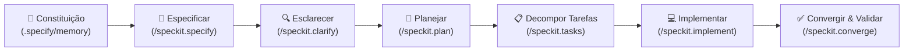

# HelenBox

Projeto estruturado sob a metodologia **Spec-Driven Development (SDD)** utilizando o padrão oficial **Spec Kit** e suporte nativo ao **Gemini Pro / Antigravity**.

---

## 📐 Metodologia Spec Kit

O HelenBox adota a metodologia orientada a especificações para garantir:
- **Zero Redundância**: Nenhuma duplicação de lógica ou código boilerplate (Princípio DRY estrito).
- **Prevenção de Erros**: Validação antecipada de requisitos, tipagem rigorosa e contratos definidos antes do código.
- **Rastreabilidade Total**: Todo código implementado tem origem direta em uma história de usuário e uma especificação aprovada.

### O Ciclo de Desenvolvimento



---

## 🗂️ Estrutura do Repositório

```text
HelenBox/
├── .agents/
│   └── skills/                   # Skills do Antigravity (speckit-specify, speckit-plan, etc.)
├── .gemini/
│   └── commands/                 # Comandos TOML do Gemini CLI (/speckit.specify, etc.)
├── .specify/
│   ├── memory/
│   │   └── constitution.md       # Regras fundamentais e governança do HelenBox
│   ├── templates/                # Templates oficiais do Spec Kit
│   │   ├── constitution-template.md
│   │   ├── spec-template.md
│   │   ├── plan-template.md
│   │   ├── tasks-template.md
│   │   └── checklist-template.md
│   └── scripts/                  # Scripts de automação (PowerShell, Bash, Python)
├── specs/                        # Diretório onde as features do projeto serão criadas
│   └── README.md
└── README.md                     # Documentação inicial do projeto
```

---

## ⚡ Comandos Disponíveis

| Comando | Descrição |
|---|---|
| `/speckit.constitution` | Visualiza ou atualiza a governança e princípios do projeto |
| `/speckit.specify` | Cria a especificação funcional (`spec.md`) a partir de requisitos |
| `/speckit.clarify` | Identifica e resolve dúvidas e ambiguidades nos requisitos |
| `/speckit.plan` | Cria o plano arquitetural e técnico (`plan.md`) |
| `/speckit.tasks` | Gera o checklist sequencial de tarefas (`tasks.md`) |
| `/speckit.implement` | Executa a implementação controlada de cada tarefa |
| `/speckit.checklist` | Executa checagens de validação e critérios de qualidade |
| `/speckit.converge` | Valida a conformidade do código contra as especificações |
| `/speckit.analyze` | Analisa consistência entre código, testes e specs |

---

## 🎯 Próximo Passo

A estrutura do Spec Kit está 100% organizada e pronta. Você já pode apresentar os detalhes e requisitos do projeto **HelenBox** para darmos início à primeira especificação (`specs/001-...`).
