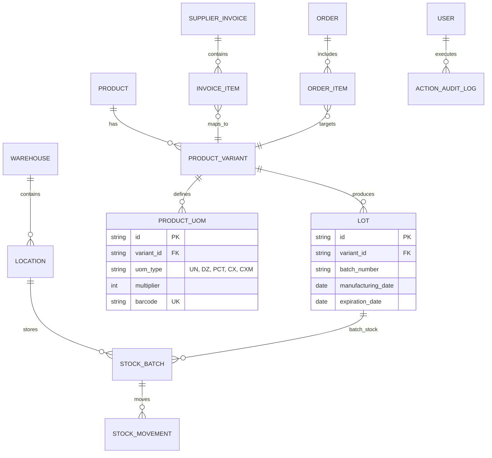

# Data Model Specification (Supabase / PostgreSQL)

**Feature**: HelenBox WMS & Gestão Inteligente de Estoque  
**Data**: 2026-10-26  
**Banco de Dados Alvo**: Supabase (PostgreSQL 15+) com Realtime  

---

## 1. Diagrama de Relacionamento de Entidades



---

## 2. Tabelas e Definições de Esquema

### 2.1 `warehouses` (Depósitos Físicos)
| Campo | Tipo | Descrição |
|---|---|---|
| `id` | UUID DEFAULT gen_random_uuid() | Chave primária |
| `code` | VARCHAR(10) UNIQUE NOT NULL | Ex: `DEP1`, `DEP2` |
| `name` | VARCHAR(100) NOT NULL | Ex: "Galpão Principal - Matriz", "Galpão 2 - Filial" |
| `address` | TEXT NOT NULL | Endereço físico completo |
| `active` | BOOLEAN DEFAULT TRUE | Status do galpão |
| `created_at` | TIMESTAMPTZ DEFAULT now() | Data de cadastro |

---

### 2.2 `locations` (Endereçamento Físico WMS)
| Campo | Tipo | Descrição |
|---|---|---|
| `id` | UUID DEFAULT gen_random_uuid() | Chave primária |
| `warehouse_id` | UUID REFERENCES warehouses(id) | Depósito associado |
| `aisle` | VARCHAR(10) NOT NULL | Rua (ex: `A`, `B`, `R01`) |
| `shelf` | VARCHAR(10) NOT NULL | Prateleira (ex: `01`, `02`, `P03`) |
| `level` | VARCHAR(10) NOT NULL | Nível / Andar (ex: `N1`, `N2`) |
| `position` | VARCHAR(10) | Posição ou vão específico |
| `full_code` | VARCHAR(50) UNIQUE NOT NULL | Ex: `DEP1-R02-P04-N01` |

---

### 2.3 `products` (Catálogo HelenBox)
| Campo | Tipo | Descrição |
|---|---|---|
| `id` | UUID DEFAULT gen_random_uuid() | Chave primária |
| `sku_helenbox` | VARCHAR(50) UNIQUE NOT NULL | SKU interno canônico (ex: `HB-CUT-OIL-5ML`) |
| `supplier_code` | VARCHAR(50) NOT NULL | Código de fábrica original da China (ex: `HYYY-001-3`) |
| `name_pt` | VARCHAR(255) NOT NULL | Nome em português |
| `name_cn` | VARCHAR(255) | Nome original em chinês |
| `brand` | VARCHAR(100) DEFAULT 'Helen Color' | Marca |
| `category` | VARCHAR(100) NOT NULL | Categoria |
| `has_expiry` | BOOLEAN DEFAULT FALSE | Se o produto possui data de validade |
| `image_url` | TEXT | Foto do produto |
| `box_length_cm` | NUMERIC(10,2) | Comprimento da caixa master |
| `box_width_cm` | NUMERIC(10,2) | Largura da caixa master |
| `box_height_cm` | NUMERIC(10,2) | Altura da caixa master |
| `gross_weight_kg` | NUMERIC(10,3) | Peso bruto da caixa master |
| `net_weight_kg` | NUMERIC(10,3) | Peso líquido da caixa master |
| `created_at` | TIMESTAMPTZ DEFAULT now() | Data de cadastro |

---

### 2.4 `product_variants` (Variações / Aromas / Cores)
| Campo | Tipo | Descrição |
|---|---|---|
| `id` | UUID DEFAULT gen_random_uuid() | Chave primária |
| `product_id` | UUID REFERENCES products(id) ON DELETE CASCADE | Produto pai |
| `variant_sku` | VARCHAR(60) UNIQUE NOT NULL | SKU da variação (ex: `HB-CUT-OIL-MOR`) |
| `aroma_flavor` | VARCHAR(100) | Aroma (ex: "Morango", "Chocolate", "Café") |
| `color_tone` | VARCHAR(50) | Tom / Cor |
| `volume` | VARCHAR(20) DEFAULT '5ml' | Volume unitário |
| `image_url` | TEXT | Foto da variação específica |

---

### 2.5 `product_uoms` (Unidades de Medida e Códigos de Barra Específicos)
| Campo | Tipo | Descrição |
|---|---|---|
| `id` | UUID DEFAULT gen_random_uuid() | Chave primária |
| `variant_id` | UUID REFERENCES product_variants(id) ON DELETE CASCADE | Variação |
| `uom_type` | VARCHAR(10) NOT NULL | `UN`, `DZ`, `PCT`, `CX`, `CXM` |
| `description` | VARCHAR(100) NOT NULL | Ex: "Unidade Avulsa (1 pc)", "Dúzia (12 pcs)", "Caixa Master (1200 pcs)" |
| `multiplier` | INTEGER NOT NULL | Fator de conversão em unidades básicas (ex: UN=1, DZ=12, CXM=1200) |
| `barcode` | VARCHAR(60) UNIQUE NOT NULL | Código de barras prefixado (ex: `DZ-789123456789`) |
| `is_default_sale` | BOOLEAN DEFAULT FALSE | Embalagem padrão de venda |

---

### 2.6 `lots` (Lotes e Datas de Validade para FEFO)
| Campo | Tipo | Descrição |
|---|---|---|
| `id` | UUID DEFAULT gen_random_uuid() | Chave primária |
| `variant_id` | UUID REFERENCES product_variants(id) ON DELETE CASCADE | Variação |
| `batch_number` | VARCHAR(50) NOT NULL | Número do lote de fabricação |
| `manufacturing_date` | DATE | Data de fabricação |
| `expiration_date` | DATE | Data de validade (usado na ordenação FEFO) |
| `created_at` | TIMESTAMPTZ DEFAULT now() | Data de registro |

---

### 2.7 `stock_batches` (Saldo Físico por Lote e Localização)
| Campo | Tipo | Descrição |
|---|---|---|
| `id` | UUID DEFAULT gen_random_uuid() | Chave primária |
| `lot_id` | UUID REFERENCES lots(id) ON DELETE CASCADE | Lote correspondente |
| `location_id` | UUID REFERENCES locations(id) ON DELETE CASCADE | Coordenada física no galpão |
| `quantity_units` | INTEGER NOT NULL DEFAULT 0 | Saldo total em unidades |
| `updated_at` | TIMESTAMPTZ DEFAULT now() | Data de atualização |

---

### 2.8 `stock_movements` (Auditoria Imutável de Movimentações)
| Campo | Tipo | Descrição |
|---|---|---|
| `id` | UUID DEFAULT gen_random_uuid() | Chave primária |
| `lot_id` | UUID REFERENCES lots(id) | Lote movimentado |
| `from_location_id` | UUID REFERENCES locations(id) | Origem |
| `to_location_id` | UUID REFERENCES locations(id) | Destino |
| `movement_type` | VARCHAR(20) NOT NULL | `IN_INVOICE`, `OUT_ORDER`, `TRANSFER`, `UNBOX`, `ADJUST` |
| `quantity_units` | INTEGER NOT NULL | Quantidade movimentada (em unidades) |
| `barcode_scanned` | VARCHAR(60) NOT NULL | Código de barras lido no leitor |
| `uom_detected` | VARCHAR(10) NOT NULL | `UN`, `DZ`, `PCT`, `CX`, `CXM` |
| `order_id` | UUID REFERENCES orders(id) | Pedido associado |
| `user_id` | UUID NOT NULL | Usuário que realizou a ação |
| `user_name` | VARCHAR(100) NOT NULL | Nome do usuário |
| `created_at` | TIMESTAMPTZ DEFAULT now() | Data/hora |
| `notes` | TEXT | Observações |

---

### 2.9 `action_audit_logs` (Auditoria de Ações, Pesquisas e Segurança)
| Campo | Tipo | Descrição |
|---|---|---|
| `id` | UUID DEFAULT gen_random_uuid() | Chave primária |
| `user_id` | UUID NOT NULL | Usuário que executou |
| `user_name` | VARCHAR(100) NOT NULL | Nome do usuário |
| `action_type` | VARCHAR(30) NOT NULL | `LOGIN`, `LOGOUT`, `SEARCH`, `VIEW_LOCATION`, `SCAN_OUT`, `INVOICE_IMPORT`, `UNBOX` |
| `query_term` | VARCHAR(255) | Termo pesquisado no estoque (quando aplicável) |
| `target_id` | VARCHAR(100) | ID do produto, localização ou invoice |
| `details` | JSONB | Metadados extras, filtros aplicados ou IP |
| `created_at` | TIMESTAMPTZ DEFAULT now() | Data/hora precisa |

---

## 3. Script de Migração SQL Supabase (`supabase/migrations/20261026000000_init_helenbox.sql`)

```sql
-- Habilita extensão de UUID
CREATE EXTENSION IF NOT EXISTS "uuid-ossp";

-- 1. Warehouses
CREATE TABLE warehouses (
    id UUID PRIMARY KEY DEFAULT uuid_generate_v4(),
    code VARCHAR(10) UNIQUE NOT NULL,
    name VARCHAR(100) NOT NULL,
    address TEXT NOT NULL,
    active BOOLEAN DEFAULT TRUE,
    created_at TIMESTAMPTZ DEFAULT now()
);

-- 2. Locations
CREATE TABLE locations (
    id UUID PRIMARY KEY DEFAULT uuid_generate_v4(),
    warehouse_id UUID REFERENCES warehouses(id) ON DELETE CASCADE,
    aisle VARCHAR(10) NOT NULL,
    shelf VARCHAR(10) NOT NULL,
    level VARCHAR(10) NOT NULL,
    position VARCHAR(10),
    full_code VARCHAR(50) UNIQUE NOT NULL
);

-- 3. Products
CREATE TABLE products (
    id UUID PRIMARY KEY DEFAULT uuid_generate_v4(),
    sku_helenbox VARCHAR(50) UNIQUE NOT NULL,
    supplier_code VARCHAR(50) NOT NULL,
    name_pt VARCHAR(255) NOT NULL,
    name_cn VARCHAR(255),
    brand VARCHAR(100) DEFAULT 'Helen Color',
    category VARCHAR(100) NOT NULL,
    has_expiry BOOLEAN DEFAULT FALSE,
    image_url TEXT,
    box_length_cm NUMERIC(10,2),
    box_width_cm NUMERIC(10,2),
    box_height_cm NUMERIC(10,2),
    gross_weight_kg NUMERIC(10,3),
    net_weight_kg NUMERIC(10,3),
    created_at TIMESTAMPTZ DEFAULT now()
);

-- 4. Product Variants
CREATE TABLE product_variants (
    id UUID PRIMARY KEY DEFAULT uuid_generate_v4(),
    product_id UUID REFERENCES products(id) ON DELETE CASCADE,
    variant_sku VARCHAR(60) UNIQUE NOT NULL,
    aroma_flavor VARCHAR(100),
    color_tone VARCHAR(50),
    volume VARCHAR(20) DEFAULT '5ml',
    image_url TEXT
);

-- 5. Product UOMs (Códigos de barra por embalagem: UN, DZ, PCT, CX, CXM)
CREATE TABLE product_uoms (
    id UUID PRIMARY KEY DEFAULT uuid_generate_v4(),
    variant_id UUID REFERENCES product_variants(id) ON DELETE CASCADE,
    uom_type VARCHAR(10) NOT NULL,
    description VARCHAR(100) NOT NULL,
    multiplier INTEGER NOT NULL,
    barcode VARCHAR(60) UNIQUE NOT NULL,
    is_default_sale BOOLEAN DEFAULT FALSE
);

-- 6. Lots (Controle de validade FEFO)
CREATE TABLE lots (
    id UUID PRIMARY KEY DEFAULT uuid_generate_v4(),
    variant_id UUID REFERENCES product_variants(id) ON DELETE CASCADE,
    batch_number VARCHAR(50) NOT NULL,
    manufacturing_date DATE,
    expiration_date DATE,
    created_at TIMESTAMPTZ DEFAULT now()
);

-- 7. Stock Batches (Saldo físico)
CREATE TABLE stock_batches (
    id UUID PRIMARY KEY DEFAULT uuid_generate_v4(),
    lot_id UUID REFERENCES lots(id) ON DELETE CASCADE,
    location_id UUID REFERENCES locations(id) ON DELETE CASCADE,
    quantity_units INTEGER NOT NULL DEFAULT 0,
    updated_at TIMESTAMPTZ DEFAULT now(),
    UNIQUE(lot_id, location_id)
);

-- 8. Orders & Items
CREATE TABLE orders (
    id UUID PRIMARY KEY DEFAULT uuid_generate_v4(),
    order_number VARCHAR(50) UNIQUE NOT NULL,
    channel VARCHAR(20) NOT NULL,
    customer_name VARCHAR(150) NOT NULL,
    status VARCHAR(20) NOT NULL,
    total_items INTEGER DEFAULT 0,
    created_at TIMESTAMPTZ DEFAULT now()
);

CREATE TABLE order_items (
    id UUID PRIMARY KEY DEFAULT uuid_generate_v4(),
    order_id UUID REFERENCES orders(id) ON DELETE CASCADE,
    variant_id UUID REFERENCES product_variants(id) ON DELETE CASCADE,
    uom_type VARCHAR(10) DEFAULT 'UN',
    quantity_ordered INTEGER NOT NULL,
    quantity_scanned INTEGER DEFAULT 0,
    location_id UUID REFERENCES locations(id),
    lot_id UUID REFERENCES lots(id),
    status VARCHAR(20) DEFAULT 'PENDING'
);

-- 9. Stock Movements (Auditoria imutável)
CREATE TABLE stock_movements (
    id UUID PRIMARY KEY DEFAULT uuid_generate_v4(),
    lot_id UUID REFERENCES lots(id),
    from_location_id UUID REFERENCES locations(id),
    to_location_id UUID REFERENCES locations(id),
    movement_type VARCHAR(20) NOT NULL,
    quantity_units INTEGER NOT NULL,
    barcode_scanned VARCHAR(60) NOT NULL,
    uom_detected VARCHAR(10) NOT NULL,
    order_id UUID REFERENCES orders(id),
    user_id UUID NOT NULL,
    user_name VARCHAR(100) NOT NULL,
    created_at TIMESTAMPTZ DEFAULT now(),
    notes TEXT
);

-- 10. Action Audit Logs (Logs de segurança e pesquisas)
CREATE TABLE action_audit_logs (
    id UUID PRIMARY KEY DEFAULT uuid_generate_v4(),
    user_id UUID NOT NULL,
    user_name VARCHAR(100) NOT NULL,
    action_type VARCHAR(30) NOT NULL,
    query_term VARCHAR(255),
    target_id VARCHAR(100),
    details JSONB,
    created_at TIMESTAMPTZ DEFAULT now()
);

-- Índices de Alta Performance
CREATE INDEX idx_product_uoms_barcode ON product_uoms(barcode);
CREATE INDEX idx_products_supplier_code ON products(supplier_code);
CREATE INDEX idx_products_sku ON products(sku_helenbox);
CREATE INDEX idx_lots_expiry ON lots(expiration_date ASC);
CREATE INDEX idx_stock_batches_lot ON stock_batches(lot_id);
CREATE INDEX idx_stock_batches_location ON stock_batches(location_id);
CREATE INDEX idx_audit_created ON action_audit_logs(created_at DESC);
CREATE INDEX idx_audit_user ON action_audit_logs(user_id);
```
